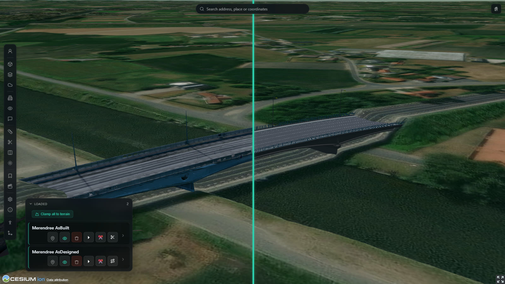
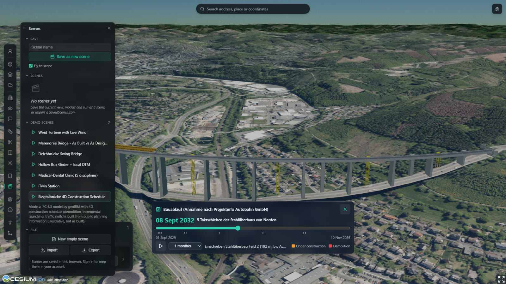

# geoBIM.app

**BIM x GIS = Geospatial Intelligence** · *Apps für den Ingenieurbau. openBIM. openSource.*

[Open the viewer](https://viewer.geobim.app) · [Demo](https://viewer.geobim.app/demo) · [Features](FEATURES.md) · [Changelog](CHANGELOG.md)




---

## What is geoBIM.app?

geoBIM.app is a web viewer for BIM and infrastructure models in their real surroundings. It streams
IFC models, reality meshes, point clouds and GIS data as OGC 3D Tiles with CesiumJS and places them on
terrain, imagery and city models — in the browser, without installation, for engineers, clients,
authorities and the public.

- **Open formats** — IFC 2x3 / 4 / 4.3 (incl. IfcAlignment), 3D Tiles 1.1, glTF, I3S, LAS/LAZ/E57,
  Gaussian splats, GeoJSON, Shapefile, KML, GPX, WMS/WMTS/WFS.
- **Own IFC tiler** — IFC files are converted on the geoBIM.app server with all property sets and
  their georeferencing (`IfcMapConversion`, `IfcSite`), no Cesium ion needed.
- **Works without an account** — guests get open terrain (Mapterhorn), open base maps and the demo
  scenes; Cesium ion is optional.

Part of a small family: the **geoBIM.app** web viewer (this repo), [ifc.geoBIM.app](https://github.com/geobim-app/ifc-geobim)
(IFC viewer for infrastructure, based on ifc-lite), the **geobim-tiler** (server-side IFC → 3D Tiles),
**geoBIM Desktop** (Unreal Engine 5 + Cesium for Unreal, same scene format) and the company website
[geobim.app](https://geobim.app). The tiler and the desktop app are not public.

---

## Features

**Models & data**
- Self-hosted 3D Tiles and GLB models, Cesium ion assets (own account via OAuth), Bentley iTwin iModels, ArcGIS I3S scene layers
- IFC and point cloud upload (up to 3 GB) with server-side tiling; move, rotate and save the position of any model
- GIS files by drag & drop (GeoJSON, Shapefile, KML/KMZ, GPX, FlatGeobuf) with CRS from the file
- Gaussian splats as native 3D Tiles (`KHR_gaussian_splatting`)
- **Rhino Plugin** — Upload Rhino models straight from Rhino 8 (IFC 4 via the geobim-tiler, georeferenced from map coordinates or the EarthAnchorPoint); repo `geobim-rhino`
- **Site Analysis** — Contours, slope, aspect, cut & fill (balanced grade level, regions with volumes) and elevation profiles for a drawn site, on the Mapterhorn DGM or the active terrain; grade a level planum with slopes into the terrain itself (export LandXML, GLB); export as GeoJSON, CSV, PNG and SVG

**Terrain & maps**
- Terrain: Mapterhorn (open DGM, no ion), ArcGIS World Elevation, Cesium World Terrain; heights via GCG2016 / EGM2008 geoid
- Base maps: TopPlusOpen, basemap.de, Bavarian DOP20/DTK, Esri, Bing / Google (ion); Google Photorealistic 3D Tiles, OSM Buildings, NRW LoD2
- 59 verified WMS/WMTS/WFS presets, ArcGIS MapServer layers

**Inspect & analyse**
- IFC and Revit filters by class / category, element properties, hide and isolate elements
- Measurements (distance, area, height, vertical, coordinates in WGS84, UTM and Gauß-Krüger)
- Clipping polygons with excavation pit, section planes per model, sections along an IfcAlignment axis, a line or a plan — with a 2D drawing and SVG export
- 4D: construction schedule from the IFC (`IfcTask`) and stage sequencing from properties
- Split view (per model left / right, own base map left), sun and shadows, wind turbine shadow flicker

**Collaborate**
- Scenes: save camera, models, terrain, base map and sun — compatible with geoBIM Desktop's `SavedScenes.json`; demo scenes for everyone
- Share a scene with a link: customers open it without an account, navigate, measure and comment; their comments appear live in your viewer
- 3D annotations with categories and inspection data, BCF 2.1 export, saved views, screenshots

**Navigate & present**
- Panel UI with icon rail (default) or classic sidebar; works on phones
- Walk Mode (first person: WASD, mouse, gamepad, collision), Third-Person mode with a character, VR with WebXR (Meta Quest)
- Image-based lighting, HBAO, post-processing, Eye Dome Lighting for point clouds, performance presets

**Live data**
- OGC SensorThings API (FROST-Server, MQTT) for structural health monitoring, Pegelonline water levels

**Demo Mode** — open without sign-in: [viewer](https://viewer.geobim.app/demo) with the demo scenes,
[wind turbine shadow flicker](https://viewer.geobim.app/wea-shadow), [bridge inspection](https://viewer.geobim.app/bridge-inspector),
[StageTwin](https://viewer.geobim.app/stage-twin) (shareable 4D construction stages).

The full list with all files is in [FEATURES.md](FEATURES.md).



---

## Do I need Cesium ion?

No. The viewer runs as a guest with open terrain and base maps, and self-hosted models need no ion at
all. A [Cesium ion](https://cesium.com/platform/cesium-ion/) account (free Community plan available)
adds Cesium World Terrain, Bing / Google imagery, Google Photorealistic 3D Tiles, OSM Buildings and your
own ion assets — connect it from the viewer. Check Cesium's [pricing](https://cesium.com/platform/cesium-ion/pricing/)
for commercial use.

Esri base maps without an API key are meant for development and non-commercial use; set
`GEOBIM_CONFIG.arcgis.apiKey` in `config.js` for production.

---

## Getting started (local)

Requirements: PHP 8 (the viewer needs its small PHP API), Git, a Firebase project for sign-in.

```bash
git clone https://github.com/geobim-app/geobim.git
cd geobim
cp config.example.js config.js     # fill in your Firebase web config
```

```powershell
.\dev\serve.ps1                    # http://localhost:8000/
```

- **Cesium ion (optional):** a token restricted to `http://localhost:8000` in `~/.geobim/ion-dev-token.txt`;
  `api/ion-config.php` hands it to the viewer. Without it the viewer runs like a guest.
- **Server models:** read-only from a folder of tilesets (`-ModelDir`, see `api/_dev.php`); they show
  after signing in with the owner account.
- **Not available locally:** uploads and their conversion, the owner session cookie. Test those on a server.
- **Checks before every commit** (Git Bash, UTF-8 locale): `LC_ALL=C.UTF-8 bash qa-check.sh` — must report 0 errors.

## Self-hosting and forks

geoBIM.app is static files plus a PHP API under `api/`, served by Apache — no build step. For your own
installation:

- **Owner account:** set your email in `GEOBIM_OWNER_EMAILS` (`api/_owner_auth.php`) and in
  `labUsers` (`core.js`); the owner uploads, places, shares and deletes models.
- **Session secret:** `/etc/geobim/session-secret` (random string) signs the owner session cookie.
- **Models:** `model/` (not in git) holds self-hosted tilesets and GLBs; it must be writable by PHP
  (uploads, saved positions, share links).
- **IFC and point cloud conversion:** the upload hands files to a worker (`scripts/convert_pointcloud.py`)
  that uses py3dtiles for point clouds and the geobim-tiler for IFC. The tiler is not public, so a fork
  converts point clouds but not IFC; use Cesium ion's tiler for IFC instead.
- **Share links:** need the Firestore rules from [DEPLOYMENT.md](DEPLOYMENT.md).
- **Deployment** of geoBIM.app itself (GitHub Action → `staging` / `main`): [DEPLOYMENT.md](DEPLOYMENT.md).

---

## Architecture

| Layer | Technology |
|---|---|
| 3D rendering | CesiumJS 1.147 (CDN), 3D Tiles 1.1, PBR neutral tone mapping, HBAO |
| Front end | Vanilla JavaScript modules (IIFE) extending one global `BimViewer` object, no framework, no bundler |
| Back end | PHP 8 API (`api/`): model list and files, uploads, saved positions, share links, ion token |
| Conversion | geobim-tiler (IFC → 3D Tiles with properties and georeferencing), py3dtiles (point clouds), Cesium ion (optional) |
| Auth & data | Firebase Authentication (email / password), Firestore (comments, measurements, scenes) |
| Hosting | Apache on a single VPS, deployed by a GitHub Action |

Each feature is its own module (`feature-name.js` + `feature-name-styles.css`), loaded in a fixed
order from `index.html`. The module reference is at the end of [FEATURES.md](FEATURES.md); project
conventions for contributors are in [CLAUDE.md](CLAUDE.md).

---

## Data and credits

- **Demo scenes:** wind turbine "Animated Wind Turbine" by Glowbox 3D (CC BY 4.0) with live wind from
  Deutscher Wetterdienst via Bright Sky; Merendree reality mesh by erkki.bartczak, Geomatics Research
  Group, KU Leuven (CC BY 4.0); Medical-Dental test files by buildingSMART International (CC BY 4.0);
  terrain DGM1 © Bayerische Vermessungsverwaltung (CC BY 4.0); further IFC 4.3 models by geoBIM.
  Full credits appear in the viewer under *Data attribution*.
- **Terrain and maps:** Mapterhorn and its sources, BKG (TopPlusOpen, basemap.de, GCG2016), Bayerische
  Vermessungsverwaltung, Esri, Cesium ion.
- **Bridge monitoring demo** (`sensorthings.js`): a structural health monitoring scenario on
  [FROST-Server](https://github.com/FraunhoferIOSB/FROST-Server) (OGC SensorThings API 1.1), sensor
  typologies after U. Retze, *Beispielhafte Untersuchung zum Einsatz von Monitoringmethoden an einer
  Brücke*, Universität der Bundeswehr München
  ([PDF](https://athene-forschung.unibw.de/doc/85913/85913.pdf)); bridge mesh by the Geomatics Research
  Group, KU Leuven ([UAS-assisted bridge inspections](https://iiw.kuleuven.be/onderzoek/geomatics/uas-assisted-bridge-inspections)).

---

## License

Licensed under the [Mozilla Public License 2.0](LICENSE) (MPL-2.0). You may use, modify and
redistribute geoBIM.app, including commercially. Modified MPL-licensed files must stay under the MPL;
your own modules in separate files may use any license. The name and logo "geoBIM.app" are not covered
by the license.

## Contact

geoBIM.app is developed by [Christof Lorenz](https://www.linkedin.com/in/christoflorenz). Project
implementations, hosting, support and consulting on geospatial BIM, digital twins and CesiumJS:
[geobim.app](https://geobim.app) · [info@geobim.app](mailto:info@geobim.app).
